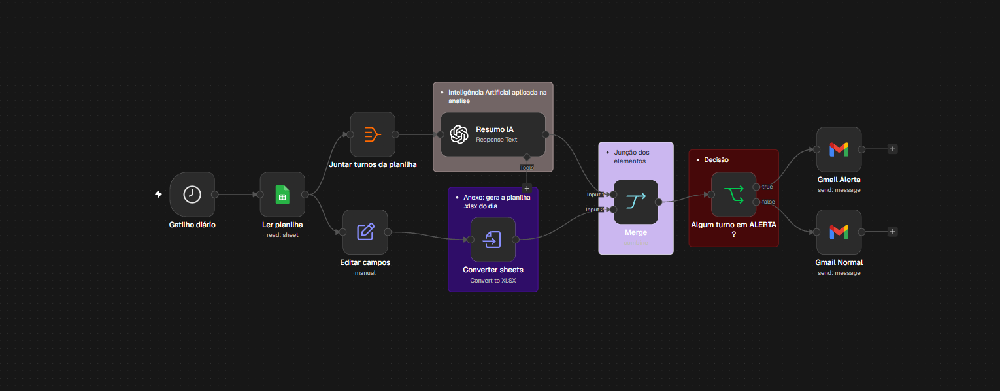
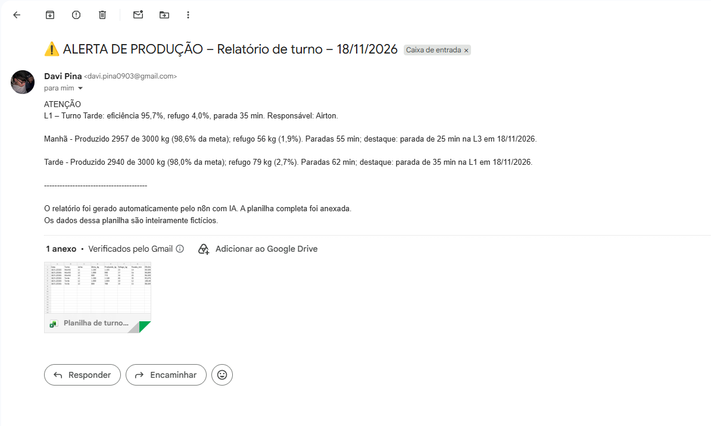
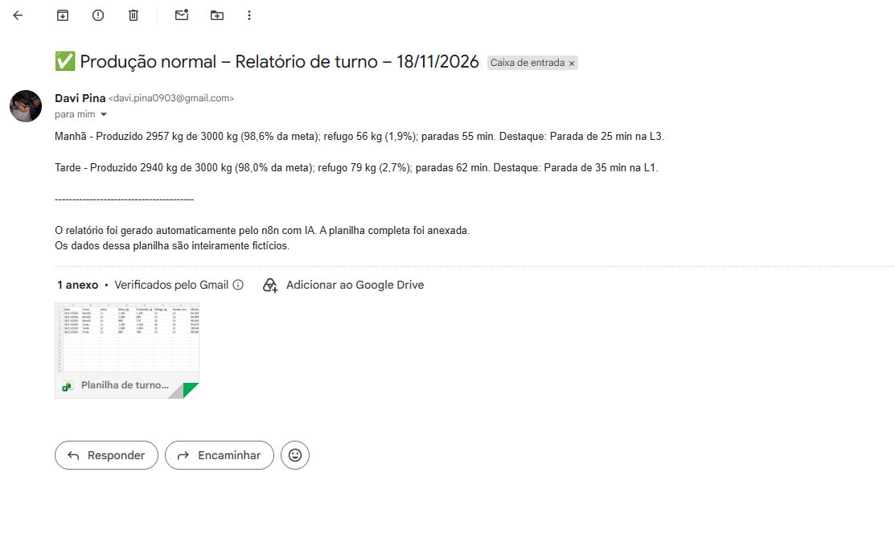
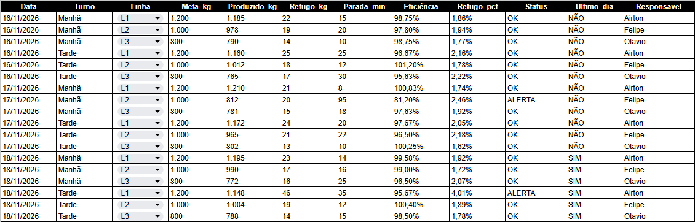
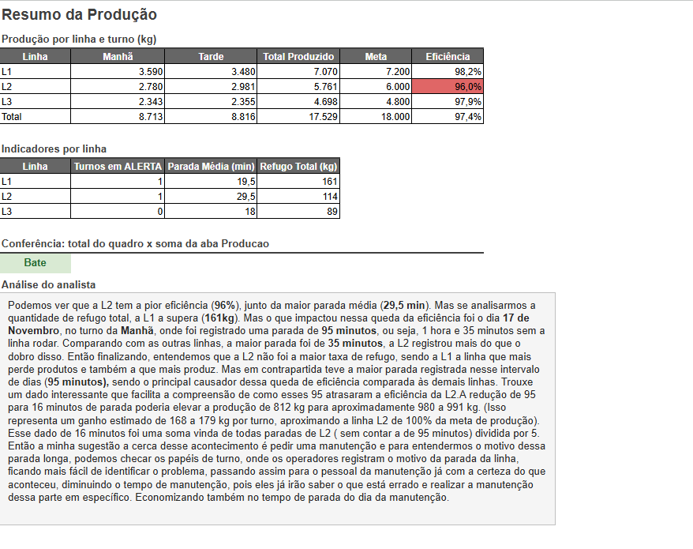
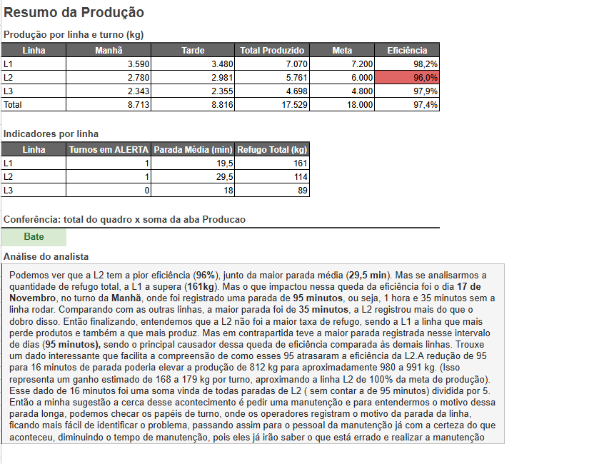

# Relatório de turno automático: planilha de produção + n8n + IA

Automação que lê a planilha de produção, usa IA para resumir o último dia de turnos e envia um e-mail para o supervisor: um **e-mail de alerta** quando algum turno sai do normal, ou um **e-mail normal** quando está tudo dentro da meta. A planilha completa do dia vai anexada.

> ⚠️ **Aviso:** todos os dados deste projeto são 100% fictícios, gerados com IA. Nenhum dado real de empresa foi usado.

---

## O problema

Num setor de produção, o supervisor precisa saber no fim do dia como cada linha foi: quanto produziu, quanto perdeu de refugo, quanto tempo ficou parada e se algum turno saiu da meta. Sem automação, isso significa abrir a planilha, filtrar o dia, calcular os números e procurar os problemas na mão, todos os dias.

## A solução

- A **planilha** calcula sozinha a eficiência, o refugo e o status (OK ou ALERTA) de cada turno.
- Todo dia, o **n8n** lê só os turnos do último dia, a **IA** escreve um resumo curto por turno e o **Gmail** envia o relatório.
- Se algum turno estiver em ALERTA, o e-mail chega com outro assunto e um bloco de **ATENÇÃO** no topo, dizendo qual linha, o que aconteceu e quem é o responsável.

## Como funciona

1. **Gatilho diário:** o fluxo roda sozinho todos os dias às 17h (horário de São Paulo).
2. **Ler planilha:** busca no Google Sheets só as linhas com `Ultimo_dia = SIM`, ou seja, os 6 turnos do dia mais recente.
3. **Juntar turnos da planilha:** junta os 6 turnos num pacote só, para a IA ler o dia inteiro de uma vez.
4. **Resumo IA:** a IA escreve o resumo da Manhã e da Tarde e, se houver ALERTA, abre o texto com o turno, os números e o responsável.
5. **Editar campos → Converter sheets:** em paralelo, limpa as colunas de controle e gera a planilha `.xlsx` do dia para anexar.
6. **Merge:** junta o texto da IA com o anexo.
7. **Algum turno em ALERTA?:** se sim, vai para o **Gmail Alerta**. Se não, vai para o **Gmail Normal**.
8. **Aviso de erro:** se o fluxo falhar (credencial expirada, planilha fora do ar), um segundo workflow manda um e-mail avisando a falha.

## Destaques

- **A conta é da planilha e o texto é da IA:** os números saem das fórmulas, e a IA só redige. Isso evita que a IA invente ou erre cálculo.
- **Limites editáveis:** a regra do ALERTA (eficiência abaixo de 85% ou refugo acima de 3%) fica na aba **Config**. Mudou a regra, a planilha inteira se atualiza.
- **Conferência automática:** a aba Resumo compara o total do quadro com a soma da aba Producao e mostra "Bate" ou "Não bate".
- **Responsável por linha:** a aba Linhas guarda quem responde por cada linha, e o PROCX traz o nome para o alerta.
- **Dois caminhos testados:** o e-mail de alerta e o normal foram testados alterando os dados.
- **Monitoramento:** workflow de erro ligado ao fluxo principal.

## Prints

**E-mail de alerta**

**E-mail normal**

**Aba Producao:** os dados de cada turno e as colunas calculadas

**Aba Resumo:** os indicadores por linha, a conferência e a análise

**Aba Leia-me:** como usar a planilha

## Análise dos dados (16 a 18/11)

**A L2 teve a pior eficiência do período (96,0%), e a causa foi uma única parada de 95 minutos no turno da manhã de 17/11.**

- A L2 também teve a maior parada média (29,5 min), enquanto a L1 teve o maior refugo total (161 kg).
- Sem aquela parada, a parada média da L2 nos outros 5 turnos cai para **16,4 min**, menor que a da L1 (19,5) e a da L3 (18). Ou seja, a L2 não é uma linha com problema crônico: foi um **evento isolado**.
- Pela estimativa do analista, com uma parada de 16 min em vez de 95, aquele turno teria produzido entre 980 e 991 kg em vez de 812 kg, um ganho de 168 a 179 kg.
- **Recomendação:** consultar os papéis de turno de 17/11 para identificar o motivo da parada e passar essa informação para a manutenção antes da intervenção, o que reduz o tempo de diagnóstico e de máquina parada.

## Como rodar

1. Baixe `Producao_Turnos.xlsx` e suba no Google Drive como **Planilhas Google**.
2. No n8n, importe `workflows/Relatorio_de_turnos.json` e `workflows/erro_automacao.json` (menu **⋯ → Import from file**).
3. Conecte as suas credenciais: **Google Sheets**, **OpenAI** e **Gmail**.
4. No nó **Ler planilha**, escolha a sua cópia da planilha e a aba **Producao**.
5. Nos nós de Gmail, troque `seu-email@exemplo.com` pelo seu e-mail.
6. No workflow principal, em **⋯ → Settings → Error Workflow**, escolha o workflow de erro.
7. Ative (publique) os dois workflows.

## Tecnologias

- Google Sheets (SE, OU, MÁXIMO, PROCX, SOMASES, CONT.SES, MÉDIASES, validação de dados, formatação condicional)
- n8n (Schedule Trigger, Google Sheets, Aggregate, OpenAI, Edit Fields, Convert to File, Merge, IF, Gmail, Error Trigger)
- OpenAI
- Gmail

## Uso de IA neste projeto

- Os dados da planilha foram **gerados com IA**.
- O acabamento visual das abas Resumo e Leia-me foi aplicado por um **agente de IA (Claude) conectado ao Google Sheets**.
- As fórmulas, o fluxo no n8n, os testes e a análise dos dados foram feitos por mim.

## Demonstração

https://github.com/user-attachments/assets/586fa9da-be30-4b75-8ce2-747bca92c0c9

---

Feito por **Davi William de Pina**.
